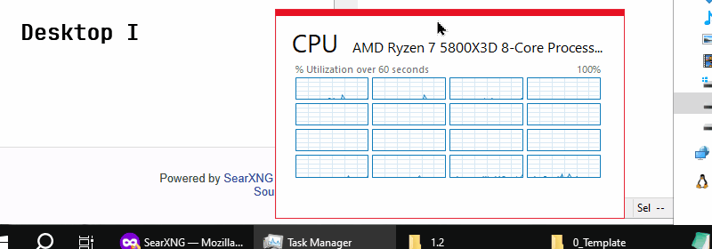

# [Move Window Between Desktops](https://fai-solutions.codeberg.page/move-window-between-desktops/)

Windows 10 and 11 let you switch between virtual desktops using `Ctrl + Win + Arrow`, but they don’t offer a built-in shortcut for moving the currently active window between desktops. This lightweight utility fills that gap by letting you send the active window to the next or previous virtual desktop with a single keyboard shortcut. It makes managing multiple workspaces far more efficient and dramatically improves your workflow.

Below is a demo of how a Task Manager is moved across virtual desktops I to VI with `Ctrl + Shift + Win + Right Arrow`:


---

## Keyboard Shortcuts and Features

### Move Window Across Virtual Desktops

Because laptop keyboards include an `Fn` key between ``Ctrl`` and ``Win`` keys while desktop keyboards do not, alternative hotkeys were added to maintain consistent finger distance across devices.

| Shortcut | Action |
|----------|--------|
| `Ctrl + Shift + Win + →` | Move window to next desktop (Windows style) |
| `Ctrl + Shift + Win + ←` | Move window to previous desktop (Windows style) |
| `Ctrl + Shift + Alt + →` | Move window to next desktop (alternative style) |
| `Ctrl + Shift + Alt + ←` | Move window to previous desktop (alternative style) |


### Switch Virtual Desktops

| Shortcut | Action |
|----------|--------|
| `Ctrl + Win + →` | Switch to next desktop (native Windows) |
| `Ctrl + Win + ←` | Switch to previous desktop (native Windows) |
| `Ctrl + Alt + →` | Switch to next desktop (alternative style) |
| `Ctrl + Alt + ←` | Switch to previous desktop (alternative style) |


### Features you can enable from the tray menu

- **Enable Cycling**: lets you switch from the last virtual desktop to the first, and vice versa (off by default)

- **Show Desktop Names**: shows virtual desktop names when switching desktops or moving the active window (on by default on Windows 10 and off by default on Windows 11)

- **Debug Logging**: logs the keystrokes used, making troubleshooting easier


## Installation Options

### Ⅰ) Setup-Installer (Recommended)

#### 1. Download and install via Setup.exe

Download the `move-window-between-desktops-setup.exe` from the [releases page](https://github.com/FAI-Solutions/move-window-between-desktops/releases/latest), double-click the setup installer and follow the on-screen instructions. During installation, you’ll be prompted for elevated privileges. Accept to enable moving elevated apps (such as Task Manager).
- Automatically configures Task Scheduler to launch the utility at every user logon
- Supports automatic updates via WinGet

#### 2. Install via WinGet (CLI)

Run PowerShell and type the following command:  
```powershell
winget install FAI-Solutions.move-window-between-desktops
```
During installation, you’ll be prompted for elevated privileges. Accept to enable moving elevated apps (such as Task Manager). To upgrade, enter the following command in PowerShell:  
```powershell
winget update FAI-Solutions.move-window-between-desktops
```


### Ⅱ) Portable ZIP

Download `move-window-between-desktops-1.4-portable.zip` from the [releases page](https://github.com/FAI-Solutions/move-window-between-desktops/releases/latest):
- Unzip the file in any folder you like
- No installation required just double click `move-window-between-desktops.exe` 
- If you want the utility to run in the background, double click the `setup-autostart.exe` and follow the instructions, it will setup the background services.


### Ⅲ) AutoHotkey Scripts (Manual Install)

1. Download and install [AutoHotkey v2](https://www.autohotkey.com/download/ahk-v2.exe) (if not already installed)
2. Download `move-window-between-desktops.ahk` and `setup-autostart.ahk` from the [releases page](https://github.com/FAI-Solutions/move-window-between-desktops/releases/latest)
3. Find and download the matching `VirtualDesktopAccessor.dll` for your Windows build (*Settings → System → About → check "OS build"*) from [VirtualDesktopAccessor's release page](https://github.com/Ciantic/VirtualDesktopAccessor/releases)
4. Place all three files together, as shown below:
```
📁 MoveWindowBetweenDesktops/
├── move-window-between-desktops.ahk    # main script
├── setup-autostart.ahk                 # autostart configuration
└── VirtualDesktopAccessor.dll          # Windows API bridge
```
5. Run `setup-autostart.ahk` and follow the instructions, this setups the Windows background services.
6. (Optional) add the official icon (in this repository: `assets/app_icon.ico`) or a custom icon and rename it to `app_icon.ico` to the same folder. The script will automatically update the tray icon.


## Troubleshooting

### Windows Defender SmartScreen Warning

If you see a SmartScreen warning (this is normal for new software):
> Windows protected your PC
> Microsoft Defender SmartScreen prevented an unrecognized app from starting. Running this app might put your PC at risk.
1. Click **More info**
2. Click **Run anyway**
3. (Otional) if Windows asks for a sample submission, please do as this usually speeds up the removal of SmartScreen warning.


### The application stops working after a major Windows update

1. Check if the icon still appears in the system tray
2. A Windows update may require a new DLL version, check [releases](https://github.com/FAI-Solutions/move-window-between-desktops/releases/latest) for updates
3. [Open an issue](github.com/FAI-Solutions/move-window-between-desktops/issues) with your Windows build number


### Cannot move elevated windows (suhc as Task Manager)

Run the application as Administrator. The installer can configure this automatically via scheduled task.

---

## Contact

- **Developer**: Johannes Faber — [fais.udder466@passinbox.com](mailto:fais.udder466@passinbox.com)
- **Hub-Website**: <a href="https://fai-solutions.github.io/" rel="me noopener">https://fai-solutions.github.io/</a>
- **App-Website**: <a href="https://fai-solutions.codeberg.page/move-window-between-desktops/" rel="me noopener">https://fai-solutions.codeberg.page/move-window-between-desktops/</a>
- **Repository**: <a href="https://codeberg.org/FAI-Solutions/move-window-between-desktops" rel="me noopener">https://codeberg.org/FAI-Solutions/move-window-between-desktops</a>
- **Repository**: <a href="https://github.com/FAI-Solutions/move-window-between-desktops" rel="me noopener">https://github.com/FAI-Solutions/move-window-between-desktops</a>


## License

[MIT](LICENSE)


## Acknowledgements

- [AutoHotkey v2](https://www.autohotkey.com/) — The scripting language that powers this utility. AutoHotkey is a free, open-source scripting language for Windows that allows users to easily create scripts for automating tasks and customizing hotkeys.

- [VirtualDesktopAccessor](https://github.com/Ciantic/VirtualDesktopAccessor) by Jari Pennanen — The DLL that provides access to Windows' virtual desktop API (MIT License).

---

**Enjoy a feature Microsoft should have included long ago!**
